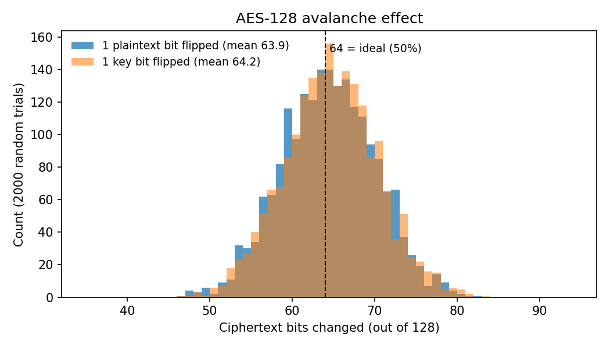
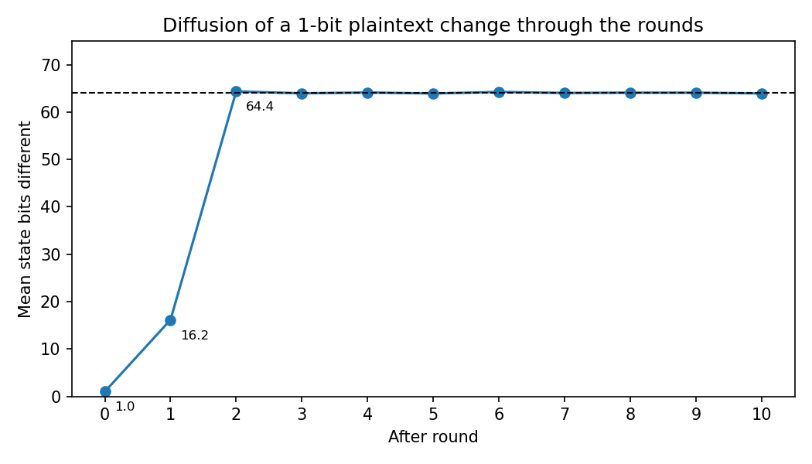

# AES-128 Encryption Core in Verilog


An iterative, self-checking **AES-128 encryption core** in Verilog HDL, verified in Vivado against the official NIST FIPS-197 vectors and an independent Python reference model. B.Tech project, team of two.

**Phase 1 (this repo):** RTL, behavioural simulation, synthesis reports.
**Phase 2 (Dec 2026 - Feb 2027):** decryption, UART interface, Artix-7 board demo, pipelined variant.

---

## Highlights

| Metric | Result |
|---|---|
| Architecture | Iterative, one round per clock, on-the-fly key expansion |
| Latency | **11 clock cycles** per 128-bit block |
| Throughput @ 100 MHz | 128 bits / 11 cycles x 100 MHz = **about 1.16 Gbit/s** |
| Functional verification | **102 / 102 vectors pass** (2 FIPS-197 + 100 random) |
| FIPS-197 Appendix B | All 11 round keys and states reproduced in simulation |
| Area (synthesis) | **1344 LUTs, 390 flip-flops, 0 BRAM, 0 DSP** |
| Timing @ 100 MHz | **WNS +4.912 ns (met)**, est. Fmax about 196 MHz |
| Avalanche (1 plaintext bit flipped) | 63.93 of 128 bits change (49.95%), 2000 trials |
| Avalanche (1 key bit flipped) | 64.19 of 128 bits change (50.15%) |
| Full diffusion | After round 2 (1 -> 16.2 -> 64.4 differing bits) |
| Target device | Artix-7 `xc7a35tcpg236-1` |

---

## Architecture

```
 plaintext ──► XOR ◄── key            (round 0, on 'start')
               │
               ▼
        ┌──── state reg ◄──────────────────────────────┐
        │                                              │
        ▼                                              │
   SubBytes ─► ShiftRows ─► MixColumns ─┬─► XOR ───────┤
                    │      (skip in round 10)  ▲        │
                    └──────────────────────────┘        │
   round_key reg ─► KeyExpand(Rcon[round]) ────► next_key
   round counter 1..10 (FSM) ─► done pulse, ciphertext reg
```

**Design decisions**

- **One round per clock.** A single round datapath is reused for all 10 rounds, keeping area small. Round 0 (the initial AddRoundKey) happens on `start`, so a block takes 1 + 10 = **11 cycles**.
- **On-the-fly key expansion.** Each round key is derived from the previous one while encrypting, so one 128-bit key register is stored instead of all 11 round keys.
- **ShiftRows costs no logic.** It is a fixed re-ordering of wires.
- **MixColumns uses `xtime`.** Multiplication in GF(2^8) is a left shift, followed by an XOR with `0x1B` when the top bit was set. It is skipped in round 10, as the standard requires.

### Modules

| File | Role |
|---|---|
| `rtl/aes128_core.v` | **Top module.** FSM, state register, round counter, ties everything together |
| `rtl/aes_sub_bytes.v`, `rtl/aes_sbox.v` | SubBytes (16 parallel S-boxes) |
| `rtl/aes_shift_rows.v` | ShiftRows (wiring only) |
| `rtl/aes_mix_columns.v` | MixColumns (GF(2^8) `xtime` logic) |
| `rtl/aes_key_expand.v` | On-the-fly round-key generation (RotWord, SubWord, Rcon) |

---

## Verification

Correctness is checked three independent ways:

1. **Official vectors.** The FIPS-197 Appendix B example, compared round by round.
2. **Independent model.** `python/aes_ref.py` is a golden Python model with the same structure as the RTL. The algorithm and the RTL byte ordering were checked against FIPS-197 and an independent AES library (500 random blocks) using a cycle-level Python mirror of the RTL.
3. **Random vectors.** 100 random (key, plaintext, ciphertext) triples from `python/gen_vectors.py`.

| Testbench | What it checks |
|---|---|
| `tb/tb_aes_units.v` | Unit tests for each block. Expect **6 PASS** lines. |
| `tb/tb_aes128_core.v` | Self-checking: FIPS round trace, 102 vectors, latency measurement |
| `tb/test_vectors.mem` | 102 vectors: 2 FIPS-197 + 100 random |

### Simulation result (Vivado 2018.3, behavioural)

```
==== SUMMARY ====
   Vectors tested : 102
   PASS           : 102
   FAIL           : 0
   Latency        : 11 cycles/block
   Throughput     : 128 bits / 11 cycles = 11.63 bits/cycle
   RESULT         : ALL TESTS PASSED
```


*Waveform of the self-checking testbench: `start` launches each encryption, `done` pulses when the ciphertext is ready, `pass_count` rises per vector and `fail_count` stays 0.*

### FIPS-197 Appendix B trace (excerpt)

Key `2b7e151628aed2a6abf7158809cf4f3c`, plaintext `3243f6a8885a308d313198a2e0370734`:

| Round | Round key | State after round |
|---|---|---|
| 0 | `2b7e151628aed2a6abf7158809cf4f3c` | `193de3bea0f4e22b9ac68d2ae9f84808` |
| 1 | `a0fafe1788542cb123a339392a6c7605` | `a49c7ff2689f352b6b5bea43026a5049` |
| 5 | `d4d1c6f87c839d87caf2b8bc11f915bc` | `f1006f55c1924cef7cc88b325db5d50c` |
| 10 | `d014f9a8c9ee2589e13f0cc8b6630ca6` | `3925841d02dc09fbdc118597196a0b32` (ciphertext) |

The full 11-round trace is in `results/expected_vivado_console.txt`.

### Avalanche effect

A one-bit input change flips about half of the 128 output bits, and full diffusion is reached after round 2.




---

## Synthesis results

Synthesized **out of context** (the core has 260 I/O pins, more than a small FPGA package offers) for `xc7a35tcpg236-1` with a 10 ns (100 MHz) clock constraint, using Vivado 2018.3.

| Resource | Used | Available | Util % |
|---|---|---|---|
| Slice LUTs | 1344 | 20800 | 6.46 |
| Slice Registers (FF) | 390 | 41600 | 0.94 |
| F7 / F8 Muxes | 320 / 160 | 16300 / 8150 | 1.96 |
| Block RAM | 0 | 50 | 0.00 |
| DSP | 0 | 90 | 0.00 |

| Timing @ 100 MHz | Result |
|---|---|
| Setup WNS | +4.912 ns, 0 failing endpoints (met) |
| Hold WHS | +0.417 ns, 0 failing endpoints |
| Critical path | State register -> S-box logic -> state register, 5 logic levels (4 LUT6 + 1 MUXF7) |
| Estimated Fmax | about 1000 / (10 - 4.912) = **196 MHz** |

> Fmax is a post-synthesis estimate: routing delay is not final, so the figure after implementation will be lower. The "no input/output delay" warnings are expected for out-of-context synthesis.

Reproduce from the `vivado/` folder:

```tcl
source synth_report.tcl
```

Reports are written to `vivado/reports/utilization_synth.txt` and `timing_synth.txt`.

---

## Repository layout

```
.
├── rtl/        Verilog design (core + 5 submodules)
├── tb/         Testbenches and test_vectors.mem
├── python/     Golden model, vector generator, avalanche analysis
├── vivado/     Project-creation and synthesis Tcl scripts
└── results/    Reference console output, round trace, avalanche plots, waveform
```

---

## Quick start

### Option A: one command

In the Vivado Tcl Console:

```tcl
cd <repo>/vivado
source create_project.tcl      ;# creates the project and runs the simulation
```

### Option B: Vivado GUI

1. *Create Project* -> RTL Project -> part `xc7a35tcpg236-1` (any part works for simulation).
2. *Add Sources -> Design sources*: all files in `rtl/`.
3. *Add Sources -> Simulation sources*: both files in `tb/` **and** `tb/test_vectors.mem`.
4. Right-click `tb_aes_units` -> *Set as Top* -> *Run Behavioral Simulation*. Expect 6 PASS lines.
5. Set `tb_aes128_core` as top and run again. Expect `RESULT : ALL TESTS PASSED`.
6. In the waveform window, add `dut/round`, `dut/state`, `dut/round_key`, set the radix to Hexadecimal and zoom to one 11-cycle encryption.

---

## Python tools

```bash
cd python
python aes_ref.py            # round-by-round trace of the FIPS example
python gen_vectors.py 100    # regenerate vectors (update NUM_VECTORS in the testbench if you change the count)
python avalanche.py          # avalanche plots (needs matplotlib)
```

---

## Roadmap

| Milestone | Scope |
|---|---|
| Phase 1 (done) | Iterative encryptor, FIPS-197 and random verification, synthesis reports |
| Dec 31 | Decryption core (inverse transforms, reverse key schedule); round trip `Decrypt(Encrypt(x)) = x` on all 102 vectors |
| Jan 31 | UART interface (115200 baud, 8N1) on Artix-7; PC script checks 10,000 random blocks on hardware |
| Feb 28 | Fully pipelined core (one block per clock), area / speed / power comparison, final demo |

---

## Troubleshooting

| Symptom | Fix |
|---|---|
| `test_vectors.mem` not found, or all FAIL with `x` values | Add the `.mem` file as a **simulation source** |
| Simulation stops at 1000 ns | Settings -> Simulation -> `xsim.simulate.runtime` = `all` (the Tcl script sets this) |
| Waveform shows only testbench signals | Scope window -> expand `dut` -> drag signals into the wave window, then *Restart* + *Run All* |
| Synthesis error "too many I/Os" | Use `synth_report.tcl` (out-of-context mode); the board wrapper comes in Phase 2 |

---

## References

- NIST, *FIPS-197: Advanced Encryption Standard (AES)*, 2001 (updated 2023). Appendices A-C give the key expansion and test vectors used here.
- AMD, *Vivado Design Suite User Guide: Logic Simulation (UG900)* and *Synthesis (UG901)*.
- C. Paar and J. Pelzl, *Understanding Cryptography*, Springer, chapter 4.
